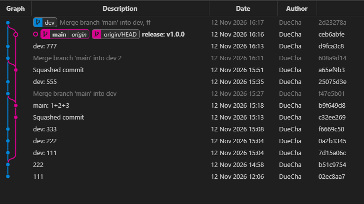

# git命令学习

```sh
# 1. 从 main 创建 dev 分支
git checkout -b dev      # git checkout -b dev main

# 2. 在 dev 上正常开发、频繁提交
git add -A
git commit -m "dev: 111"
git add -A
git commit -m "dev: 222"
# ... 反复多次

# 3. （可选）定期把 main 的更新同步回 dev，避免偏离
git checkout dev
git merge main
git commit -m "Merge branch 'main' into dev 222"

# 4. 发版时把 dev 合并到 main —— 关键命令
git checkout main
git merge --squash dev        # 把所有 dev 提交压成一个暂存变更
git commit -m "release: v1.0.0"   # main 上只多这 1 个提交

```

# 截图


